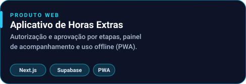
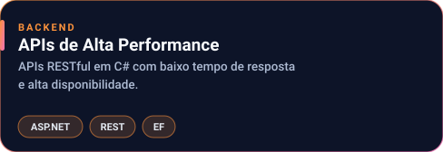
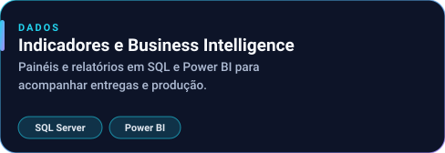

  

  
  
  
  

Engenheiro de software sênior, com foco em **.NET** e **Angular**, construindo sistemas corporativos de alta performance. Trabalho de ponta a ponta, do banco de dados à interface, com atenção a **desempenho, confiabilidade e experiência de quem usa**. Gosto de entregar, medir e evoluir.

<table>
  <tr>
    <td width="33%" valign="top"><b>🏢 Sistemas corporativos</b> Aplicações de negócio com regras complexas, integrações e muito dado.</td>
    <td width="33%" valign="top"><b>☁️ Cloud, DevOps e arquitetura</b> Pipelines, entregas contínuas e arquitetura pensada para escalar.</td>
    <td width="33%" valign="top"><b>🌱 Aprendizado contínuo</b> Trilhas e certificações da Microsoft e projetos reais para praticar.</td>
  </tr>
</table>

  

Commits e pull requests de repositórios corporativos (Azure DevOps), de jul/2025 a out/2026. Entregas são itens concluídos no Azure Boards em 2026.

  

  
  

  

<table>
  <tr>
    <td width="50%"></td>
    <td width="50%"></td>
  </tr>
  <tr>
    <td width="50%"></td>
    <td width="50%"></td>
  </tr>
  <tr>
    <td width="50%"></td>
    <td width="50%"></td>
  </tr>
</table>

  
  

  <b>214 selos</b> de módulos concluídos &nbsp;·&nbsp; <b>53 troféus</b> de roteiros de aprendizagem 
  Power Platform, Power Automate, Dynamics 365, Copilot, Power BI, desenvolvimento web, C# e segurança, conformidade e identidade da Microsoft.

#### 🏅 Selos em destaque

  
  
  
  
  
  
  
  
  
  
  
  

<b>Ver todos os selos</b> (145 distintos)

 

  
  
  
  
  
  
  
  
  
  
  
  
  
  
  
  
  
  
  
  
  
  
  
  
  
  
  
  
  
  
  
  
  
  
  
  
  
  
  
  
  
  
  
  
  
  
  
  
  
  
  
  
  
  
  
  
  
  
  
  
  
  
  
  
  
  
  
  
  
  
  
  
  
  
  
  
  
  
  
  
  
  
  
  
  
  
  
  
  
  
  
  
  
  
  
  
  
  
  
  
  
  
  
  
  
  
  
  
  
  
  
  
  
  
  
  
  
  
  
  
  
  
  
  
  
  
  
  
  
  
  
  
  

#### 🏆 Troféus em destaque

  
  
  
  
  
  
  
  
  
  

<b>Ver todos os troféus</b> (39 distintos)

 

  
  
  
  
  
  
  
  
  
  
  
  
  
  
  
  
  
  
  
  
  
  
  
  
  
  
  
  
  

Perfil com Power Platform, Dynamics 365 e Power BI: nível 12, 192 selos e 48 troféus, conclusões anteriores registradas nessa conta em 29/06/2026 (<a href="https://learn.microsoft.com/pt-br/users/walidmarghata-0755/">ver</a>). Perfil com desenvolvimento web, C# e segurança: nível 6, 22 selos e 5 troféus (<a href="https://learn.microsoft.com/pt-br/users/walidmarghata-7262/">ver</a>). Números de 15/10/2026.

  
  
  

  

