

  

  
  
  
  
  

&nbsp;

  
  
  
  

Senior software engineer focused on **.NET** and **Angular**, building high-performance enterprise systems. I work end to end, from the database to the interface, with attention to **performance, reliability and user experience**. I like to deliver, measure and improve.

<table>
  <tr>
    <td width="33%" valign="top"><b>🏢 Enterprise systems</b> Business applications with complex rules, integrations and lots of data.</td>
    <td width="33%" valign="top"><b>☁️ Cloud, DevOps and architecture</b> Pipelines, continuous delivery and architecture designed to scale.</td>
    <td width="33%" valign="top"><b>🌱 Continuous learning</b> Microsoft learning paths and certifications, plus real projects to practice.</td>
  </tr>
</table>

  

Commits and pull requests from corporate repositories (Azure DevOps), from Jul 2025 to Oct 2026. Deliveries are items completed in Azure Boards in 2026.


  

  
  

  

<table>
  <tr>
    <td width="50%">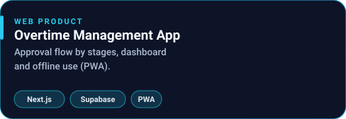</td>
    <td width="50%">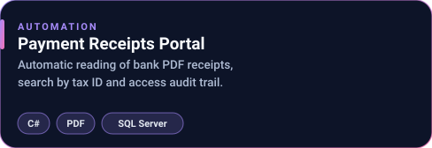</td>
  </tr>
  <tr>
    <td width="50%">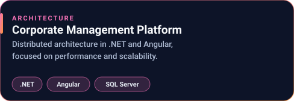</td>
    <td width="50%">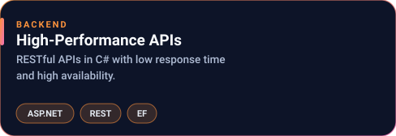</td>
  </tr>
  <tr>
    <td width="50%">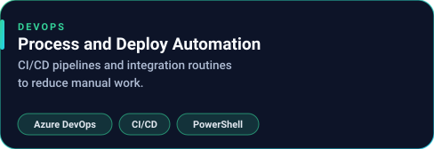</td>
    <td width="50%">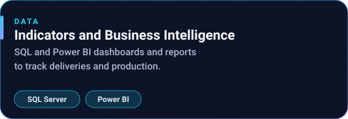</td>
  </tr>
</table>


  

#### 🎓 Education

  

#### 📄 Publications

<table>
  <tr>
    <td width="50%">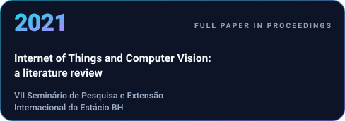</td>
    <td width="50%">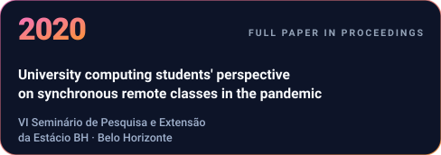</td>
  </tr>
</table>

#### 🌍 Languages

  

  
  

  <b>214 badges</b> for completed modules &nbsp;·&nbsp; <b>53 trophies</b> for learning paths 
  Power Platform, Power Automate, Dynamics 365, Copilot, Power BI, web development, C# and Microsoft security, compliance and identity.

Profile with Power Platform, Dynamics 365 and Power BI: level 12, 192 badges and 48 trophies, earlier completions registered on that account on 29 Jun 2026 (<a href="https://learn.microsoft.com/pt-br/users/walidmarghata-0755/">view</a>). Profile with web development, C# and security: level 6, 22 badges and 5 trophies (<a href="https://learn.microsoft.com/pt-br/users/walidmarghata-7262/">view</a>). Figures as of 15 Oct 2026.

&nbsp;

  
  
  
  

Engenheiro de software sênior, com foco em **.NET** e **Angular**, construindo sistemas corporativos de alta performance. Trabalho de ponta a ponta, do banco de dados à interface, com atenção a **desempenho, confiabilidade e experiência de quem usa**. Gosto de entregar, medir e evoluir.

<table>
  <tr>
    <td width="33%" valign="top"><b>🏢 Sistemas corporativos</b> Aplicações de negócio com regras complexas, integrações e muito dado.</td>
    <td width="33%" valign="top"><b>☁️ Cloud, DevOps e arquitetura</b> Pipelines, entregas contínuas e arquitetura pensada para escalar.</td>
    <td width="33%" valign="top"><b>🌱 Aprendizado contínuo</b> Trilhas e certificações da Microsoft e projetos reais para praticar.</td>
  </tr>
</table>

  

Commits e pull requests de repositórios corporativos (Azure DevOps), de jul/2025 a out/2026. Entregas são itens concluídos no Azure Boards em 2026.


  


  
  

  

<table>
  <tr>
    <td width="50%"></td>
    <td width="50%">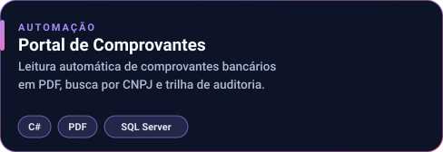</td>
  </tr>
  <tr>
    <td width="50%"></td>
    <td width="50%"></td>
  </tr>
  <tr>
    <td width="50%">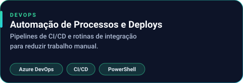</td>
    <td width="50%"></td>
  </tr>
</table>


  

#### 🎓 Formação acadêmica

  

#### 📄 Publicações

<table>
  <tr>
    <td width="50%">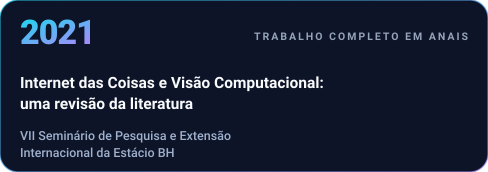</td>
    <td width="50%">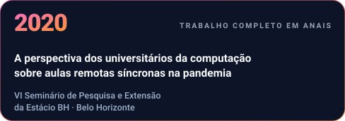</td>
  </tr>
</table>

#### 🌍 Idiomas

  

  
  

  <b>214 selos</b> de módulos concluídos &nbsp;·&nbsp; <b>53 troféus</b> de roteiros de aprendizagem 
  Power Platform, Power Automate, Dynamics 365, Copilot, Power BI, desenvolvimento web, C# e segurança, conformidade e identidade da Microsoft.

Perfil com Power Platform, Dynamics 365 e Power BI: nível 12, 192 selos e 48 troféus, conclusões anteriores registradas nessa conta em 29/06/2026 (<a href="https://learn.microsoft.com/pt-br/users/walidmarghata-0755/">ver</a>). Perfil com desenvolvimento web, C# e segurança: nível 6, 22 selos e 5 troféus (<a href="https://learn.microsoft.com/pt-br/users/walidmarghata-7262/">ver</a>). Números de 15/10/2026.

&nbsp;

  
  
  
  

مهندس برمجيات أول متخصص في **.NET** و**Angular**، أبني أنظمة مؤسسية عالية الأداء. أعمل من البداية إلى النهاية، من قاعدة البيانات إلى الواجهة، مع اهتمام بـ**الأداء والموثوقية وتجربة المستخدم**. أحب التسليم والقياس والتطوير المستمر.

<table dir="rtl">
  <tr>
    <td width="33%" valign="top"><b>🏢 الأنظمة المؤسسية</b> تطبيقات أعمال ذات قواعد معقدة وتكاملات وبيانات كثيرة.</td>
    <td width="33%" valign="top"><b>☁️ السحابة وDevOps والعمارة</b> مسارات آلية وتسليم مستمر وعمارة مصممة للتوسع.</td>
    <td width="33%" valign="top"><b>🌱 التعلّم المستمر</b> مسارات وشهادات Microsoft ومشاريع حقيقية للتطبيق.</td>
  </tr>
</table>

  

عمليات الإيداع وطلبات الدمج من مستودعات الشركة (Azure DevOps) من يوليو 2025 إلى أكتوبر 2026. الإنجازات هي عناصر مكتملة في Azure Boards خلال 2026.

  


  
  

  

<table dir="rtl">
  <tr>
    <td width="50%">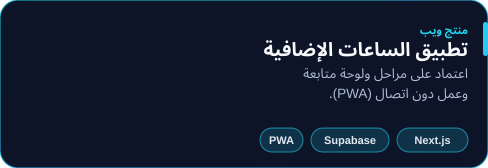</td>
    <td width="50%">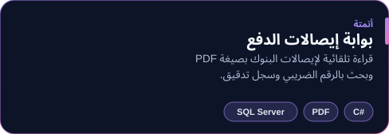</td>
  </tr>
  <tr>
    <td width="50%">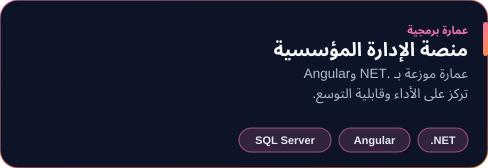</td>
    <td width="50%">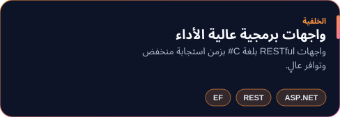</td>
  </tr>
  <tr>
    <td width="50%">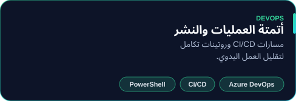</td>
    <td width="50%">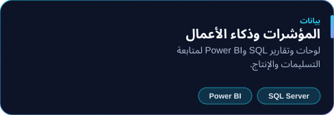</td>
  </tr>
</table>


  

#### 🎓 التعليم

  

#### 📄 المنشورات

<table dir="rtl">
  <tr>
    <td width="50%">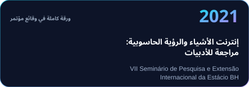</td>
    <td width="50%">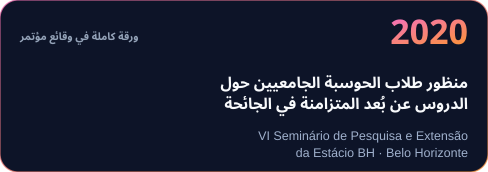</td>
  </tr>
</table>

#### 🌍 اللغات

  

  
  

  <b>214 شارة</b> لوحدات مكتملة &nbsp;·&nbsp; <b>53 كأسًا</b> لمسارات التعلّم 
  Power Platform وPower Automate وDynamics 365 وCopilot وPower BI وتطوير الويب وC# وأمن Microsoft والامتثال والهوية.

الملف الذي يضم Power Platform وDynamics 365 وPower BI: المستوى 12 و192 شارة و48 كأسًا، وقد سُجّلت الإنجازات السابقة في هذا الحساب بتاريخ 29/06/2026 (<a href="https://learn.microsoft.com/pt-br/users/walidmarghata-0755/">عرض</a>). الملف الذي يضم تطوير الويب وC# والأمن: المستوى 6 و22 شارة و5 كؤوس (<a href="https://learn.microsoft.com/pt-br/users/walidmarghata-7262/">عرض</a>). الأرقام بتاريخ 15/10/2026.

&nbsp;

  
  
  
  


Ingénieur logiciel senior, spécialisé en **.NET** et **Angular**, je construis des systèmes d'entreprise hautes performances. Je travaille de bout en bout, de la base de données à l'interface, avec le souci de la **performance, de la fiabilité et de l'expérience utilisateur**. J'aime livrer, mesurer et progresser.

<table>
  <tr>
    <td width="33%" valign="top"><b>🏢 Systèmes d'entreprise</b> Applications métier avec règles complexes, intégrations et beaucoup de données.</td>
    <td width="33%" valign="top"><b>☁️ Cloud, DevOps et architecture</b> Pipelines, livraison continue et architecture pensée pour passer à l'échelle.</td>
    <td width="33%" valign="top"><b>🌱 Apprentissage continu</b> Parcours et certifications Microsoft, et projets réels pour pratiquer.</td>
  </tr>
</table>

  

Commits et pull requests de dépôts d'entreprise (Azure DevOps), de juil. 2025 à oct. 2026. Les livraisons sont les éléments terminés dans Azure Boards en 2026.


  

  
  

  

<table>
  <tr>
    <td width="50%">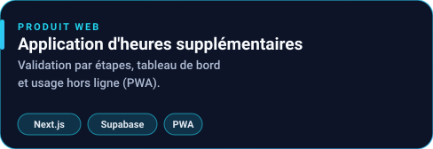</td>
    <td width="50%">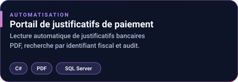</td>
  </tr>
  <tr>
    <td width="50%">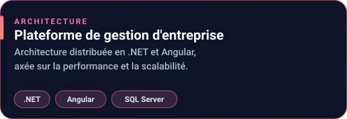</td>
    <td width="50%">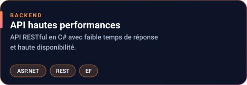</td>
  </tr>
  <tr>
    <td width="50%">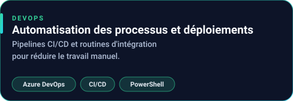</td>
    <td width="50%">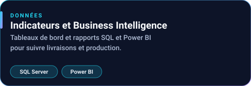</td>
  </tr>
</table>

  

#### 🎓 Formation

  

#### 📄 Publications

<table>
  <tr>
    <td width="50%"></td>
    <td width="50%"></td>
  </tr>
</table>

#### 🌍 Langues

  

  
  

  <b>214 badges</b> de modules terminés &nbsp;·&nbsp; <b>53 trophées</b> de parcours d'apprentissage 
  Power Platform, Power Automate, Dynamics 365, Copilot, Power BI, développement web, C# et sécurité, conformité et identité Microsoft.

Profil avec Power Platform, Dynamics 365 et Power BI : niveau 12, 192 badges et 48 trophées, réalisations antérieures enregistrées sur ce compte le 29/06/2026 (<a href="https://learn.microsoft.com/pt-br/users/walidmarghata-0755/">voir</a>). Profil avec développement web, C# et sécurité : niveau 6, 22 badges et 5 trophées (<a href="https://learn.microsoft.com/pt-br/users/walidmarghata-7262/">voir</a>). Chiffres au 15/10/2026.

&nbsp;

  
  
  
  

Старший инженер-программист, специализируюсь на **.NET** и **Angular**, создаю высокопроизводительные корпоративные системы. Работаю от начала до конца, от базы данных до интерфейса, с вниманием к **производительности, надёжности и удобству пользователей**. Люблю доводить дело до результата, измерять и совершенствоваться.

<table>
  <tr>
    <td width="33%" valign="top"><b>🏢 Корпоративные системы</b> Бизнес-приложения со сложными правилами, интеграциями и большим объёмом данных.</td>
    <td width="33%" valign="top"><b>☁️ Облако, DevOps и архитектура</b> Конвейеры, непрерывная поставка и архитектура, рассчитанная на рост.</td>
    <td width="33%" valign="top"><b>🌱 Постоянное обучение</b> Учебные курсы и сертификаты Microsoft, а также реальные проекты для практики.</td>
  </tr>
</table>

  

Коммиты и pull request'ы из корпоративных репозиториев (Azure DevOps) с июля 2025 по октябрь 2026. Результаты — завершённые элементы в Azure Boards за 2026 год.

  

  
  

  

<table>
  <tr>
    <td width="50%"></td>
    <td width="50%"></td>
  </tr>
  <tr>
    <td width="50%"></td>
    <td width="50%"></td>
  </tr>
  <tr>
    <td width="50%"></td>
    <td width="50%"></td>
  </tr>
</table>

  

#### 🎓 Образование

  

#### 📄 Публикации

<table>
  <tr>
    <td width="50%"></td>
    <td width="50%"></td>
  </tr>
</table>

#### 🌍 Языки

  

  
  

  <b>214 значков</b> за пройденные модули &nbsp;·&nbsp; <b>53 трофея</b> за учебные курсы 
  Power Platform, Power Automate, Dynamics 365, Copilot, Power BI, веб-разработка, C# и безопасность, соответствие требованиям и идентификация Microsoft.

Профиль с Power Platform, Dynamics 365 и Power BI: уровень 12, 192 значка и 48 трофеев, ранее пройденные курсы зарегистрированы в этом аккаунте 29.06.2026 (<a href="https://learn.microsoft.com/pt-br/users/walidmarghata-0755/">открыть</a>). Профиль с веб-разработкой, C# и безопасностью: уровень 6, 22 значка и 5 трофеев (<a href="https://learn.microsoft.com/pt-br/users/walidmarghata-7262/">открыть</a>). Данные на 15.10.2026.

  

🏅 145 &nbsp;·&nbsp; 🏆 39

  
  
  
  
  
  
  
  
  
  
  
  

<b>🏅 Show all badges (145)</b>

 

  
  
  
  
  
  
  
  
  
  
  
  
  
  
  
  
  
  
  
  
  
  
  
  
  
  
  
  
  
  
  
  
  
  
  
  
  
  
  
  
  
  
  
  
  
  
  
  
  
  
  
  
  
  
  
  
  
  
  
  
  
  
  
  
  
  
  
  
  
  
  
  
  
  
  
  
  
  
  
  
  
  
  
  
  
  
  
  
  
  
  
  
  
  
  
  
  
  
  
  
  
  
  
  
  
  
  
  
  
  
  
  
  
  
  
  
  
  
  
  
  
  
  
  
  
  
  
  
  
  
  
  
  

  
  
  
  
  
  
  
  
  
  

<b>🏆 Show all trophies (39)</b>

 

  
  
  
  
  
  
  
  
  
  
  
  
  
  
  
  
  
  
  
  
  
  
  
  
  
  
  
  
  

  
  
  

  

